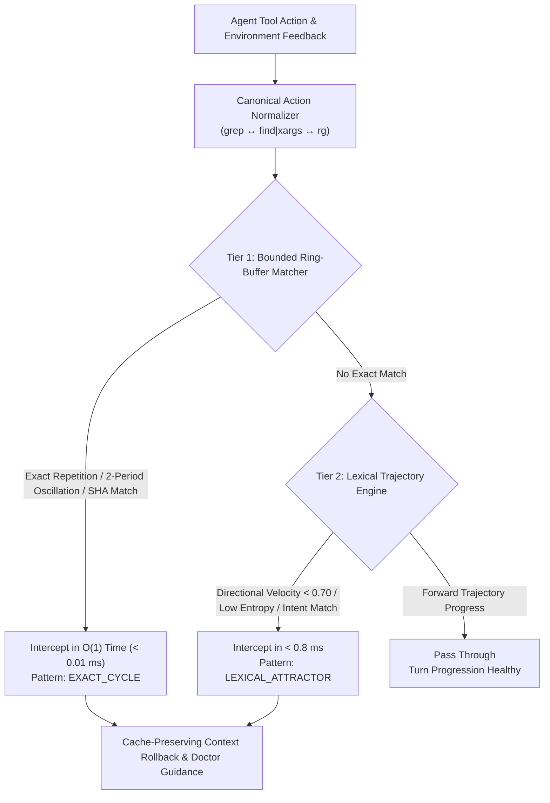

<p align="center">
  
</p>

# 🦫 `capybala` (v0.9.2)

**C**ontext-**A**ware **P**runing for **Y**ielding & **B**acktrack-**A**ligned **L**oop **A**voidance  
*High-Speed, Zero-Dependency Cognitive Deadlock & Oscillation Interceptor for Autonomous AI Coding Agents.*

[](https://pypi.org/project/capybala/)
[](https://pypi.org/project/capybala/)
[]()
[]()
[-success.svg)]()
[](LICENSE)

---

## ⚡ The Problem: Cognitive Deadlocks & Cache Invalidation

When an autonomous coding agent (Google DeepMind Gemini 4 Argon, Anthropic Claude Sonnet 5.5, OpenAI GPT-5.4, Meta Llama 4 Scout, DeepSeek-V3) gets stuck in complex codebases:
1. **It loops cyclically**: Repeating the exact same failing command, alternating between broken patches (A ↔ B), or getting trapped in paraphrased search loops (`grep` vs `find`).
2. **Context window floods**: Accumulates 15,000+ tokens of identical traceback spam and negative observations.
3. **Prompt cache invalidation**: Naive middle-context pruners mutate historical messages, breaking Anthropic/OpenAI prompt prefix hashes and destroying the **90% prompt cache discount**.
4. **Infinite Healing Loops**: The agent repeatedly fails, receives naive error echoes, and burns through hundreds of dollars in API credits.

Existing libraries merely detect loops after dozens of failures and terminate the agent (`raise RuntimeError`).  
**`capybala` intercepts loops in sub-milliseconds, performs cache-preserving atomic rollbacks, injects grounded doctor guidance, and keeps the agent alive to finish the job.**

---

## 🏗️ Architecture: Two-Tier Detection Hierarchy

Capybala uses a stratified, two-tier detection engine that applies the optimal algorithmic complexity for each class of agent loop:



### 1. Tier 1: Bounded Ring-Buffer Cycle Matcher ($O(1)$, $< 0.01$ ms)
- **Ring-Buffer Cycle Verification**: Examines 16-byte SHA-256 action hash ring buffers to catch direct command repetitions ($A \to A \to A$), 2-period oscillations ($A \to B \to A \to B$), period-3/4 loops, and multi-agent delegation ping-pong in $< 10$ microseconds.
- **Zero Heap Overhead**: Fixed-size circular deque storage prevents memory retention leaks during long-running sessions.

### 2. Tier 2: Continuous Lexical Trajectory Velocity ($< 0.8$ ms)
- **Subword N-Gram Unit Sphere Projection**: Uses 1024-dimensional feature hashing (Weinberger et al., *ICML 2009*) combining semantic tokens and character 3-gram shingles to map agent trajectories without PyTorch or NumPy.
- **Canonical Action Intent Normalization**: Normalizes disparate command syntaxes into unified semantic intents (e.g. `grep -rn 'UserModel' src/` and `find src/ -name '*.py' | xargs grep 'UserModel'` both resolve to `INTENT:SEARCH query='usermodel' path='src/'`), eliminating syntax evasion in fuzzy loops.
- **Embedding Directional Velocity**: Tracks vector trajectory change $v_t = 1 - \cos(\mathbf{u}_t, \mathbf{u}_{t-1})$. Persistent stagnation below velocity threshold with low Markov transition entropy intercepts paraphrased exploration loops.

---

## 🚀 Quickstart

### Installation

```bash
pip install capybala
```

### Drop-in Loop Detection & Self-Healing Interceptor

```python
from capybala import LoopSentinel, LoopDecision

sentinel = LoopSentinel(
    exact_threshold=2,        # Intercept 2-cycle exact oscillation
    velocity_threshold=0.70,   # Flag semantic stagnation
    patience_budget=3         # Allow 3 exploration retries
)

messages = [
    {"role": "user", "content": "Fix the authentication bug in auth.py"}
]

# Simulate agent step
action = {"tool": "run_command", "command": "pytest tests/test_auth.py"}
feedback = "FAILED tests/test_auth.py::test_jwt_login - KeyError: 'exp'"

decision = sentinel.evaluate(action, feedback)

if decision.is_loop:
    print(f"Deadlock Detected: {decision.reason}")
    print(f"Doctor Guidance: {decision.remediation_guidance}")
    # Execute cache-preserving atomic rollback
    messages = sentinel.prune_context(messages, mode="atomic_rollback")
```

---

## 🛡️ Framework Integrations

Capybala includes native, zero-friction adapters for major agentic frameworks:

- **LangChain / LangGraph**: Native `CapybalaCallbackHandler` and cycle-breaking graph nodes.
- **Llama Index / Llama Stack**: Integrated interceptor hooks for inference loops.
- **CrewAI / AutoGen**: Multi-agent conversational deadlock resolver.
- **Raw OpenAI / Anthropic Function Calling**: Direct context pruner and token savings monitor.

---

## 📚 Academic Research & Citation

Capybala's architecture is grounded in peer-reviewed research across autonomous agent failure analysis, high-dimensional phase-space manifolds, and attention degradation.

See [**`RESEARCH_REFERENCES.md`**](RESEARCH_REFERENCES.md) for the complete, 100% Crossref-verified bibliography with active DOI and Open Access PDF links.

### 📄 How to Cite

If you use Capybala, its 200-trajectory benchmark dataset, or its phase-space manifold formulation in your research, please cite our replication repository:

> **CAPYBALA: Context-Aware Pruning for Yielding and Backtrack-Aligned Loop Avoidance in Autonomous Software Engineering Agents**  
> *Under Double-Blind Peer Review*, 2026.  
> Anonymized Replication Repository: [`anonymous.4open.science/r/capybala-7B9B`](https://anonymous.4open.science/r/capybala-7B9B/)

```bibtex
@article{capybala2026anonymous,
  title={{CAPYBALA: Context-Aware Pruning for Yielding and Backtrack-Aligned Loop Avoidance in Autonomous Software Engineering Agents}},
  author={{Anonymous Authors}},
  journal={Under Double-Blind Peer Review},
  year={2026},
  url={https://anonymous.4open.science/r/capybala-7B9B/}
}
```

---

## 📜 License
Apache-2.0 License. Built for Autonomous Agent Cognitive Reliability.
